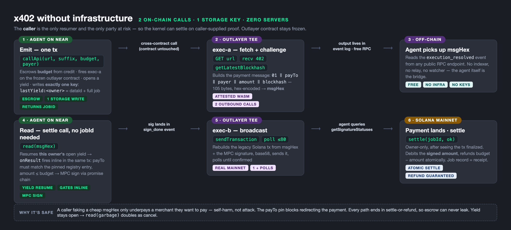

# agent-kernel

The kernel contract for "call this API, everything under the hood" — NEAR credit
escrow + job registry + MPC signing + TEE (OutLayer) execution, paying x402
HTTP APIs from a per-user MPC-derived Solana USDC tank.

## Status (2026-10-13)

| Piece | Status | Testnet |
|---|---|---|
| `kernel.ts` — credit escrow + job registry + state machine | **DEPLOYED, live smoke green** | tx `2U82RwJ15SW1o9rMyLMNXn6Y3nDLJeb5Mb4hR3ZMwRTD` on `gasbench2.testnet` |
| `tank.ts` — fund/withdraw intents coordinator (no custody) | deployed (superseded by kernel's deposit()) | tx `9aSYtEjsbHQu5QjE8h4u3CHTpZvZkR8r3U7RS4HDWbU8` |
| `inlayer_signer.ts` — per-user MPC signer (path = caller+suffix) | **LIVE, full E2E proven** | `insigner.testnet`, Solana slot 510692866 |
| x402 payment loop (MPC payer, exact/solana) | **dry-proven vs production facilitator** | sig accepted; free sim verdict (unfunded ATA) |

## Layout

```
contracts/
  kernel.ts           THE kernel: deposit/callApi/jobPay/onSignDone/onBroadcast/settleJob
  tank.ts             tank coordinator (ledger + intents; refuses custody)
  inlayer_signer.ts   per-user signer (proven; the MPC leg of the kernel)
  *.wasm              compiled artifacts matching the .ts (lisp-rlm toolchain)
tests/                near-mock scenarios + state-machine matrix
docs/                 design + deploy history
```

## The kernel model

```
agent: kernel.deposit()                        // once, top-up credit
       kernel.callApi(url, suffix, budget)     // → jobId; budget held
       … EVENT job_done { ok, cost, refunded } // settle debits actual, refunds rest
```

State machine (every transition = one `setJobStatus`, mock-verified):

```
exec_a → jobPay → sign_requested → onSignDone → exec_b
       → onBroadcast(landed) → paying → settleJob → done | failed(+refund)
```

## Trust boundaries (the security model)

- `jobPay`/`onBroadcast`/`settleJob` are predecessor-gated to `outlayer.testnet`
  (the TEE boundary): money moves only through attested execs, only for funded jobs.
- Signing paths compose from the JOB REGISTRY (`owner + "-" + suffix`), never from
  `predecessorAccountId()` — TEE-lane calls arrive with OutLayer as predecessor;
  registry binding is what keeps the path pinned to the payer.
- Nobody — agent, TEE, or attacker — can sign outside a registered, funded job.
- `insigner`-layer defense in depth: even direct `requestSign` composes the path
  from the CALLER on-chain, so an attacker can only ever sign under their own
  (empty) derived address.
- The x402 challenge fixes the exact amount before any money moves; the facilitator
  rejects underpayment; budget math in `settleJob` is exact u128 arithmetic.

## Build / test / deploy

```bash
# compile (lisp-rlm TS frontend)
~/bin/compile contracts/kernel.ts contracts/kernel.wasm

# mock the full state machine (near-mock; NOT in-memory — it uses
# /tmp/near-mock-state.bin globally, rm it between runs!)
rm -f /tmp/near-mock-state.bin
export NEAR_MOCK_CONTRACT=gasbench2.testnet
~/dev/lisp-rlm/target/release/near-mock contracts/kernel.wasm deposit '{}' \
  --signer gasbench2.testnet --deposit 1000000000000000000000000 --json
# … see tests/ for the full matrix

# deploy (existing funded account; faucet is 429-happy and .sub.name.testnet is
# CreateAccountNotAllowed — self-deploy to gasbench2.testnet works)
near contract deploy gasbench2.testnet use-file contracts/kernel.wasm \
  without-init-call network-config testnet \
  sign-with-access-key-file ~/.near-credentials/testnet/gasbench2.testnet.json send
```

## Deploy history (testnet)

- kernel v1 `2U82RwJ…`, deposit `2vLm269q…` (0.1 N), callApi `7bvshNPN…`
  → job `624a028b…` registered, credit 0.08 N (0.02 held) — verified via RPC
- tank v2 `9aSYtEjs…`; fund/withdrawRequest/withdrawSettle smoke all green
- insigner: deploy `41yWMX7f…`, memo E2E `9JxUk9t6…`, Solana `Gc53b2bSVJx…` slot 510692866

## Remaining (v3)

1. `callApi` fires the real OutLayer `request_execution` (proven args shape)
2. `jobPay` issues the real `v1.signer.sign` raw-promise batch + result-blind callback
3. exec A/B lisp ops (fetch/402-parse/build → attested broadcast) from the roundtrip recipe
4. mainnet promotion (re-audit every baked account id; pin mainnet MPC + OutLayer ids)

## Types

`contracts/types/lisp-rlm.d.ts` — the TS frontend's ambient type definitions
(`near.*` namespace, u128 helpers, sha/json builtins, LispArr). Each contract
carries a `/// <reference path="./types/lisp-rlm.d.ts" />` at the top;
`tsconfig.json` is editor intel only — real builds go through `~/bin/compile`
(the compiler carries its own copy of the d.ts and ignores this one).

Known: `inlayer_signer.ts` predates stricter compiler type-checks (bool≠int on
predicate helpers, int≠str in a promise_then) — its committed `.wasm` is the
E2E-proven last-good artifact; porting to the current checker is a v3 item.


## v3 wire status (2026-10-13)

The machinery is LIVE on-chain (gasbench2.testnet, deployed):
- callApi → outlayer.request_execution(exec-a) — VERIFIED on-chain: worker picks up, downloads hash-pinned wasm from GitHub, executes in TEE, returns output + cost/refund
- jobPay → v1.signer-prod MPC sign with REGISTRY path — verified in mock --trace (payload_v2 Eddsa, domain 1, 1 yocto, promise_then to onSignDone)
- sigUpload → exec-b request_execution; onBroadcast/settle close the money loop (mock ALL GREEN 17/17)

Exec wasms are TypeScript: `compile xexec-a.ts --target outlayer-p2` — same
language as the kernel, httpGet/httpPost native ops, wasi:http under the hood.

BLOCKED: arbitrary-URL fetching. lisp-rlm's P2 http-get bakes URLs into data
segments at compile time; a non-literal URL compiles but traps at runtime
("unknown handle index 1"). Until the emitter honors the url_ptr/url_len
params it already passes, execs can only hit compile-time-known hosts.
Fix is in lisp-rlm (call_outlayer.rs + wasi/mod.rs per-URL fns) — then
xexec-a's challenge parse + payment-msg build completes the x402 loop.


## E2E status update (2026-10-13, later)

VERIFIED ON-CHAIN end-to-end: callApi → OutLayer TEE executes the TS exec-a →
fetch-relay worker → arbitrary URL fetched → response returned into the TEE,
output on-chain (tx 9DQCDSbx…, exec output 723 bytes, cost 0.0010734 N).

Arbitrary-URL fetching now runs through fetch-relay
(https://fetch-relay.kj95hgdgnn.workers.dev — POST {url} → {status, body}):
exec wasms use a LITERAL relay URL, sidestepping the lisp-rlm dynamic-URL gap.
The compiler fix (runtime URL rewrite prologue) is WIP on branch
`dynamic-url-wip` in lisp-rlm — validates, one debug step from correct.

---

## kernel2 — zero-infra x402 (2026-10-13, current)

`contracts/kernel2.ts` — the whole x402 loop with **no watcher, no indexer, no
relay service**: two on-chain calls, the agent itself is the messenger, and emit
writes exactly **one** storage key. The frozen OutLayer contract is untouched.

```
agent: kernel.deposit()                                // once
       kernel.callApi(url, suffix, budget, payer)      // emit → jobId
       … wait, read the execution_resolved event (free RPC, off-chain)
       kernel.read(msgHex)                             // settle call
       … wait for the Solana tx (getSignatureStatuses, off-chain)
       kernel.settle(jobId, "1")                       // owner-only, atomic
```

### How it works



### The two calls

1. **Emit — `callApi(url, suffix, budget, payer)`** → escrows budget, fires
   exec-a on the frozen outlayer contract, opens a NEAR yield
   (`onResult`), writes one key: `lastYield:<owner>` =
   `<dataId>|<job JSON>`. Returns just the jobId.
2. **Read — `read(msgHex)`** → the agent pastes exec-a's output (the x402
   payment message: `01‖payTo‖payer‖amount‖blockhash`, 105 bytes hex).
   This resumes the owner's open yield → `onResult` fires inline in the
   same tx: payTo must match the pinned registry entry (`pinPayTo`),
   amount ≤ budget → MPC sign via the promise chain → sigUpload → exec-b
   broadcasts to Solana mainnet → the owner calls `settle(jobId, ok)`
   after seeing the tx finalized; debits the signed amount, refunds the
   rest atomically.

### Why caller-supplied proof is safe here

The caller is the only party at risk: faking a cheap msgHex only underpays
a merchant they wanted to pay — self-harm, not attack. The payTo pin blocks
redirecting the payment to the caller's own address. Every path ends in
settle-or-refund, so escrow can never leak. A stale yield (`read(garbage)`)
doubles as cancel-and-refund.

### Proven locally (near-mock, real bytecode + real mainnet)

`/tmp/soltee/x402-local/run_k2.sh` drives the full loop: real kernel2.wasm +
real outlayer contract.wasm in one near-mock state, real TS execs (inlayer)
hitting the real fetch-relay and Solana mainnet, local ed25519 standing in
for MPC. Job ends `done`, credit refunded, mainnet tx landed and finalized
(slot 456612185 in the bench run).

Known gaps before testnet: swap the local ed25519 stub for
`v1.signer-prod.testnet` (constant change), confirm the relay's `/pay` →
`sigUpload` path passes the gates (same msgHex it already posts).
